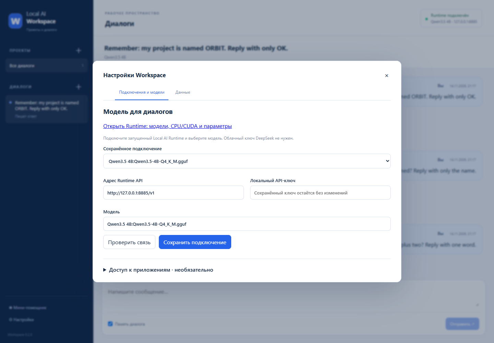
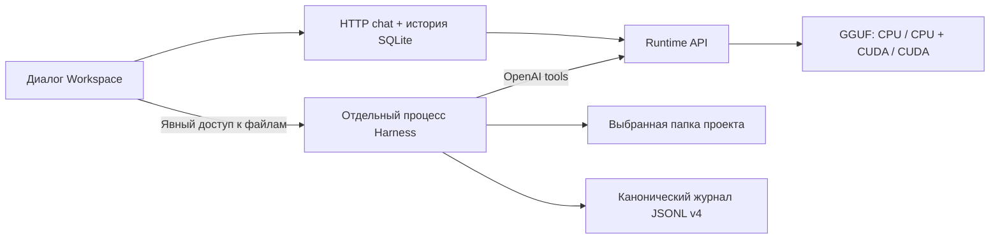

# Local AI Workspace

Workspace — отдельное приложение для **проектов и диалогов** с локальной моделью. Обычная беседа не требует проекта, папки, Git или Harness. Если нужна работа с файлами, включите её явно для проекта. Runtime загружает GGUF и считает токены; Workspace обращается к нему только по публичному HTTP API и не читает его реестр, историю или настройки.

| Компонент | Версия / контракт | Данные |
|---|---|---|
| Local AI Runtime | 1.5.0 / API 1.1 | `models_storage`, `assistant_state` |
| Local AI Workspace | 0.2.0 beta / schema 2 | `%LOCALAPPDATA%/LocalAIWorkspace` или `LOCAL_AI_WORKSPACE_DATA_DIR` |
| Необязательный Harness SDK + native runtime | Оба `0.2.2rc2` | Отдельный DSH home каждого файлового диалога |
| Канонический журнал Harness | JSONL format 4, без сжатия | `tasks/<id>/dsh/sessions` |

## Начать общение

1. Запустите Runtime отдельно: `LocalAIGPP.exe` или Linux Docker. Откройте `http://127.0.0.1:8765`, подключите GGUF и выберите параметры модели.
2. Распакуйте **всю папку** Workspace и запустите `LocalAIWorkspace.exe`. Сохраняйте `_internal` и `agent`: EXE не является одиночным переносимым файлом. Для Windows нужен WebView2 Runtime.
3. Откройте **Настройки → Подключения и модели**. Укажите `http://127.0.0.1:8765/v1` (Docker web proxy: `http://127.0.0.1:8080/v1`), нажмите «Проверить связь», выберите точный ID модели и сохраните подключение. API-ключ нужен только если вы задали его в Runtime. Облачный ключ DeepSeek не нужен.
4. Нажмите «Новый диалог» и напишите сообщение. Проект можно оставить невыбранным. Переключатель памяти управляет включением завершённых предыдущих реплик в следующий запрос.

Состояние Runtime, его адрес и выбранная модель видны в шапке. Нажатие открывает настройки подключения, а ссылка **«Открыть Runtime: модели, CPU/CUDA и параметры»** ведёт к управлению самой моделью. Зелёный статус подтверждает доступность API и выбранной модели; он не означает, что GPU в этот момент занят генерацией.

Все подключения и настройки находятся в одном модальном окне и не уменьшают область диалога. Резервная копия доступна только на вкладке **Данные**. У сообщений есть дата и время; пользователь находится справа, модель слева. Обновления ответа сохраняют ручную прокрутку. В каждом окне сохраняются собственный выбранный диалог и черновики.



## Проекты по желанию

| Вариант | Что требуется | Что происходит |
|---|---|---|
| Диалог без проекта | Только подключённая модель | Беседа сразу появляется в общем списке |
| Проект без подключения | Название | Группа диалогов без доступа к рабочим файлам |
| Папка | Абсолютный путь к существующей папке | Подключение обычной папки; Git не обязателен |
| GitHub | `https://github.com/owner/repository` | Клонирование в новую/пустую папку; Git нужен только для этой операции |

Для закрытого GitHub-репозитория заранее настройте доступ в Git на компьютере. Workspace не запрашивает пароль в форме URL. Клонирование ограничено по времени и не меняет глобальную конфигурацию Git.

## Мини-помощник

Мини-помощник принадлежит **Workspace**. Кнопка «Мини-помощник» в большом окне или трее показывает персонажа. Нажатие на персонажа раскрывает **прежнюю нативную синюю пиксельную панель с указателем слева от него**. Если слева нет места на текущем мониторе, панель располагается справа. Она не является модальным WebView-окном и не захватывает ввод остального приложения.

В панели есть:

- скрываемый список бесед и «Новый диалог»;
- продолжение выбранной беседы, память и остановка ответа;
- даты, пользователь справа, модель слева;
- отдельные черновики и сохранение ручной прокрутки;
- переход к общим настройкам или большому окну.

Выбор беседы в панели независим от большого окна. Сохранены прежние индикаторы персонажа: зелёная **✓** — готовность, синяя **?** — размышление, **…** — ответ, красная **!** — ошибка. Крестик большого окна скрывает его и оставляет персонажа; **«Выход из Workspace»** в трее завершает Workspace и принадлежащие ему запуски. Runtime имеет отдельный срок жизни.

Браузерный компактный маршрут `/mini` остаётся доступен как дополнительный вид. Windows-персонаж использует нативную Tk-панель, а не этот маршрут. Старые диагностические беседы Runtime остаются в Runtime и автоматически в Workspace не переносятся.

## Работа с файлами — отдельный режим

Выберите проект и явно включите доступ к файлам при создании диалога. По умолчанию обычный чат не запускает Harness, shell или инструменты проекта. Разрешение записи задаётся отдельно; расширение разрешений и запись в подключённое приложение требуют подтверждения.

Для файлового агента нужна модель с подтверждённым шаблоном tools и контекстом от 8192 токенов. Проверенный профиль Qwen3.5 4B: контекст **16384**, ответ **2048**, reasoning выключен, при ограниченной VRAM — смешанный CPU + CUDA. Все поддерживаемые слои на GPU требуют больше свободной видеопамяти.



Runtime возвращает предложения вызовов инструментов и сам не исполняет команды. Harness исполняет инструменты проекта в отдельном управляемом процессе. Одновременно Workspace допускает один активный запуск; Runtime допускает одну модельную операцию и возвращает 409 при занятости. Остановка адресуется только владельцу текущего запуска. Закрытие Workspace не останавливает отдельный Runtime.

Пример файловой инструкции:

> Запусти тесты, найди причину падения, исправь код минимальным изменением, повтори тесты и объясни diff. Не меняй тесты ради успешного результата.

Diff сравнивает файлы с состоянием рабочего дерева в начале запуска, сохраняя ранее существовавшие изменения отдельно. Поддерживаются Git и обычная папка; большие, бинарные, не-UTF8 файлы и ссылки за границу проекта отмечаются как пропущенные. Workspace не делает автоматический reset, checkout или откат рабочих файлов.

Qwen3.5 4B решила **11 из 20** узких случаев с внесёнными регрессиями в копии трёх реальных модулей. Это ограничение качества **файлового агента**, не результат проверки обычных бесед. Проверяйте тесты и diff. [Измерения и границы проверки](VALIDATION.md).

## История и восстановление

Обычный чат хранится в SQLite Workspace. В запрос с памятью попадают только завершённые пары пользователь/модель; оборванный ответ остаётся виден, но не становится завершённой репликой памяти. После перезапуска прерванный ответ помечается ошибкой, частичный текст сохраняется, автоматической повторной отправки нет.

В файловом режиме канонический источник событий — журнал Harness format 4. Восстановление открывает сессию **без нового входного сообщения** и сверяет её с проекцией SQLite, добавляя только недостающие события. Новая инструкция отправляется явно. Неизвестная версия журнала или нарушенная последовательность дают диагностируемую ошибку без сброса файлов. Названия `tasks` в старых API/каталогах сохранены для совместимости; пользовательский интерфейс организован вокруг бесед.

## Необязательное подключение приложения

`examples/notes_app.py` — самостоятельный локальный сервис с собственной SQLite:

```powershell
python examples/notes_app.py --data-dir .local/example-notes --port 8890
```

В **Настройки → Подключения и модели → Доступ к приложениям** добавьте `http://127.0.0.1:8890`. Чтение работает отдельно. Для записи включите writes у подключения, прикрепите его к файловому диалогу и подтвердите точное название/содержимое записи. Узкий MCP-мост предоставляет только `read_items` / `create_item` выбранных подключений и проверяет discovery до отправки инструкции.

Receipt с action ID фиксируется до HTTP-записи. Потеря ответа не вызывает автоматической повторной отправки; повтор action ID с другим содержимым отклоняется. Capability текущего запуска защищает MCP-мост, после завершения доступ закрывается. Этот пример проверяет контракт подключения; он не доказывает доступ к авторизованной рабочей сессии VetConsult.

## Запуск из исходников и сборка

Для подготовки Windows-сборки нужны Python 3.12 и Node.js 22; Git требуется для клонирования, но не для общения:

```powershell
py -3.12 -m venv workspace/.venv
workspace/.venv/Scripts/python.exe -m pip install -r workspace/requirements-desktop.txt
cd workspace/frontend
npm ci
npm run build
cd ../..
workspace/.venv/Scripts/python.exe -m workspace.launcher
# Независимая Windows-поставка:
workspace/.venv/Scripts/python.exe workspace/build_workspace.py
```

Для Linux без нативного окна:

```bash
python3 -m venv workspace/.venv
workspace/.venv/bin/python -m pip install -r workspace/requirements.txt
cd workspace/frontend && npm ci && npm run build && cd ../..
workspace/.venv/bin/python -m workspace.launcher --headless
```

Порт и данные: `--port 8776 --data-dir /absolute/path`. Для frontend dev-сервера доступен `LOCAL_AI_WORKSPACE_DEV_ORIGIN=http://127.0.0.1:5175`. Провайдеры и подключения ограничены loopback HTTP; сетевой доступ к самому сервису для локального сценария не нужен. Для Runtime Linux CPU/CUDA используйте [Docker guide](DOCKER.md).

## Обновление и резервная копия

Перед обновлением остановите активный запуск и создайте **Настройки → Данные → Резервную копию**. Она включает согласованную SQLite, каталоги сессий/DSH и настройки мини-помощника. Рабочие папки проектов в эту копию не входят. Снимок может содержать локальные ключи и диалоги, храните его как пользовательские данные.

Schema 2 мигрирует существующие проекты и беседы schema 1 без сброса. Программа отказывается открывать неизвестную будущую схему. Сборщик создаёт кандидата, проверяет native DSH/rg и SHA-256 manifest `distribution.json`, затем переключает поставку; предыдущая программа сохраняется в `workspace/build/previous-*`. Перед переключением завершите все процессы, использующие эту папку.

При откате сначала сохраните **текущие** данные, включая работу после обновления. Запускайте старую программу с отдельной копией совместимого снимка через `--data-dir`; не заменяйте текущую базу и не объединяйте журналы вручную. Runtime собирается и обновляется отдельно и не разделяет версию или каталог данных с Workspace.

## Проверки для разработчика

```powershell
python tools/run_tests.py --start tests -v
python tools/run_tests.py --start workspace/tests -v
python tools/check_tool_api.py --base-url http://127.0.0.1:8765/v1
# Укажите только одноразовый Workspace, а не рабочие пользовательские данные:
$env:WORKSPACE_URL='http://127.0.0.1:8892'
$env:RUNTIME_URL='http://127.0.0.1:8765/v1'
node tools/check_workspace_chats.cjs
# Необязательный файловый режим:
python tools/check_workspace_agent.py --output-root .local/acceptance-new
python tools/check_workspace_recovery.py .local/acceptance-new/workspace-data
python tools/check_workspace_connector.py --model 'ID из /v1/models' --project .local/connector-new --output .local/connector-result.json
```

Браузерная проверка использует установленный Playwright (`PLAYWRIGHT_MODULE`) и Edge (`EDGE_EXE`), выполняет настоящие запросы к модели и создаёт тестовые беседы/проект. `check_workspace_ui.cjs` — совместимое имя этой же проверки. Проверки файлового режима работают в отдельных временных проектах, не исправляют пользовательский репозиторий и сохраняют результаты неуспешных попыток.

Первичные контракты: [официальный DSH SDK](https://github.com/deepseek-ai/deepseek-harness/tree/39163dd30f703a79079e2d2446545cff3c453738/python/sdk), [SDK 0.2.2rc2](https://pypi.org/project/deepseek-harness-sdk/0.2.2rc2/). Фактические проверки опубликованы отдельно в [VALIDATION.md](VALIDATION.md).
