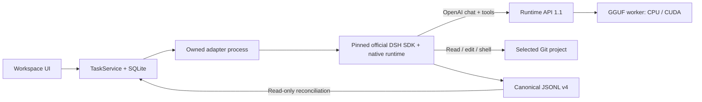

# Local AI Workspace

Workspace — отдельное приложение для работы агента с Git-проектами. Runtime загружает GGUF и считает токены; Workspace хранит проекты и задачи, запускает DeepSeek Harness, показывает действия, вывод команд, разрешения и diff. Между ними — публичный HTTP API. Workspace не импортирует backend Runtime и не читает его реестр, историю или настройки.

| Компонент | Версия / контракт | Данные |
|---|---|---|
| Local AI Runtime | 1.5.0 / API 1.1 | Существующие `models_storage`, `assistant_state` |
| Local AI Workspace | 0.2.0 / schema 1 | `%LOCALAPPDATA%/LocalAIWorkspace` или `LOCAL_AI_WORKSPACE_DATA_DIR` |
| Harness Python SDK + native runtime | Оба `0.2.2rc2` | Отдельный DSH home каждой задачи |
| Канонический журнал Harness | JSONL format 4, без сжатия | `tasks/<id>/dsh/sessions` |

Это первая версия Workspace для локальных задач. Модель Qwen3.5 4B может ошибаться в коде и вызовах инструментов. Успешный итог агента проверяйте по результату тестов и diff. Ограничения набора приёмки и измеренные результаты публикуются в [VALIDATION.md](VALIDATION.md).

## Запустить

1. Запустите Runtime отдельно: `LocalAIGPP.exe` или Linux Docker.
2. Подключите GGUF. Для агента настройте контекст **16384**, ответ **2048**, отключите reasoning Qwen и загрузите модель. При ограниченной VRAM используйте смешанный CPU + CUDA. Все поддерживаемые слои на GPU требуют больше свободной VRAM.
3. Распакуйте **всю** папку поставки Workspace и запустите `LocalAIWorkspace.exe`. Внутреннюю папку `agent` и `_internal` тоже нужно сохранять. Нативный DSH и его `rg` уже включены; Node.js и облачный ключ DeepSeek на целевой машине не нужны.
4. В «Провайдеры и модели» укажите `http://127.0.0.1:8765/v1` (Docker: `http://127.0.0.1:8080/v1`), проверьте связь и выберите точный ID из списка. Локальный API-ключ нужен только если вы задали его в Runtime.
5. Добавьте существующий Git-репозиторий по абсолютному пути. Создайте задачу. Флаг «Запись в проект» разрешает обычные изменения внутри проекта; расширение разрешений остаётся отдельным запросом.

Пример задачи:

> Запусти тесты, найди причину падения, исправь код минимальным изменением, повтори тесты и объясни diff. Не меняй тесты ради успешного результата.

Workspace доступен на `http://127.0.0.1:8776`, но владеет собственным окном и сервером. Настройки провайдера, подключения и добавление проекта открываются в модальных окнах поверх рабочего пространства и не меняют размеры задачи или diff. У каждого окна браузера — собственные выбранные проект и задача. История и состояние задач общие; их запись контролирует один процесс приложения.

Мини-помощник принадлежит **Workspace**: персонаж, иконка трея и компактный диалог `/mini` запускаются его EXE. В мини-окне можно раскрыть список задач/диалогов, выбрать сессию и продолжить её с памятью, создать новую задачу и остановить свою работу. Черновики хранятся отдельно для каждого диалога, ручная прокрутка сохраняется. Для подробных действий, diff и разрешений есть переход в большое окно.

Крестик большого окна Workspace скрывает его и оставляет помощника. Команда «Выход из Workspace» в трее завершает приложение и принадлежащие ему процессы. Runtime больше не запускает персонажа; его собственный трей относится только к модельному сервису. Старые диагностические беседы Runtime сохраняются на прежнем месте и не превращаются автоматически в агентные сессии.

### Из исходников

Python 3.12, Git и Node.js 22 нужны для подготовки исходной сборки:

```powershell
py -3.12 -m venv workspace/.venv
workspace/.venv/Scripts/python.exe -m pip install -r workspace/requirements-desktop.txt
cd workspace/frontend
npm ci
npm run build
cd ../..
workspace/.venv/Scripts/python.exe -m workspace.launcher
```

Для Linux без окна:

```bash
python3 -m venv workspace/.venv
workspace/.venv/bin/python -m pip install -r workspace/requirements.txt
cd workspace/frontend && npm ci && npm run build && cd ../..
workspace/.venv/bin/python -m workspace.launcher --headless
```

Порт и каталог данных задаются `--port 8776 --data-dir /absolute/path`. Для frontend dev-сервера можно явно разрешить его origin через `LOCAL_AI_WORKSPACE_DEV_ORIGIN=http://127.0.0.1:5175`; обычная поставка этого не требует. Все провайдеры и подключения первой версии ограничены loopback HTTP.

## Что происходит при запуске задачи



Runtime возвращает предложения вызовов инструментов и не выполняет команды. DSH исполняет инструменты проекта. На одну задачу приходится один корневой запуск в отдельном управляемом процессе; одновременно Workspace допускает одну активную задачу. Runtime допускает одну модельную операцию, без скрытой очереди: конкурентный запрос получает HTTP `409 RUNTIME_BUSY` до начала SSE.

Нативный профиль Harness задаёт реальные контекст и лимит вывода из capabilities, отключает облачные маршруты, web/office/subagent/schedule инструменты, телеметрию сессий и автоматические повторы запросов модели. Точная версия SDK проверяется при запуске; SHA-256 используемого native EXE записывается в события задачи. SDK prerelease закреплён отдельно от продуктового тега DSH.

При Stop Workspace запрашивает завершение адаптера и затем подтверждает остановку принадлежащего ему дерева. Windows использует Job Object с kill-on-close; adapter не запускает DSH до назначения Job и получения stdin-конфигурации. Linux использует отдельную группу процессов и отслеживание идентичности потомков. Отмена inference адресуется только owner ID и секретному токену этой задачи. Завершённая или неизвестная задача не отменяет запрос другого клиента.

Полный выход из Workspace останавливает его DSH-процессы; скрытие большого окна оставляет задачи и мини-помощника работающими. Самостоятельный Runtime и его клиенты продолжают работать. Завершение внешней уже подтверждённой записи нельзя отменить задним числом; для неё сохраняется отдельный receipt.

## Разрешения и неопределённый результат

«Разрешить один раз» относится к конкретному запросу. Разрешение, отказ и предложение инструмента остаются в истории; повторное использование решения отклоняется. Вопросы агента отображаются отдельно от разрешений.

Таймаут SDK или потеря канала не доказывают, что команда не выполнилась. Такая задача получает `uncertain`. После аварии Workspace помечает активные задачи как `interrupted` и отменяет старые ожидающие разрешения. Автоматическая отправка предыдущего prompt или команды запрещена.

Действие «Восстановить историю» вызывает SDK resume **без входного сообщения**. Читатель сверяет канонический журнал DSH с проекцией SQLite и добавляет только недостающие события. Неизвестная версия журнала или нарушенная последовательность дают диагностируемую ошибку; файлы не сбрасываются. После сверки пользователь может явно отправить новую инструкцию.

Diff считается относительно рабочего дерева в начале задачи, включая уже существовавшие изменения. Он не включает их как новые правки агента. Большие, бинарные, не-UTF8 файлы и ссылки за границу проекта отмечаются как пропущенные. Workspace не выполняет автоматический reset, checkout или откат файлов проекта.

## Первое подключение к приложению

Пример `examples/notes_app.py` — самостоятельный локальный сервис с собственной SQLite:

```powershell
python examples/notes_app.py --data-dir .local/example-notes --port 8890
```

В Workspace откройте «Подключения», добавьте `http://127.0.0.1:8890`. Чтение работает отдельно. Для записи нужно разрешить writes у подключения и подтвердить точное содержимое записи. Receipt с action ID фиксируется до HTTP-записи; после потери ответа повтор той же операции не отправляется автоматически.

Подключение можно явно прикрепить к новой задаче. Адаптер предоставляет Harness узкий MCP-мост `read_items` / `create_item` только для выбранных connector IDs. Перед каждой агентной записью Workspace показывает название и текст и ждёт отдельного решения. Мост защищён секретной capability текущего запуска; завершённая задача теряет доступ. Запрос модели сам по себе разрешением на запись не является.

Этот пример проверяет контракт первого подключения. Он не доказывает подключение к авторизованной рабочей сессии VetConsult и не отправляет её документы в модель.

## Сборка, обновление и восстановление

```powershell
workspace/.venv/Scripts/python.exe workspace/build_workspace.py
```

Сборщик создаёт кандидата рядом с действующей поставкой, проверяет наличие native DSH и `rg`, формирует `distribution.json` с хешами файлов и только затем переключает `workspace/dist`. Предыдущая программа сохраняется в `workspace/build/previous-*`. Runtime собирается отдельно прежним `tools/02_build_exe.py`; его данные и версия не зависят от Workspace.

Перед обновлением остановите задачи и нажмите «Снимок данных». Снимок включает согласованную SQLite и все каталоги задач/DSH. Он содержит локальные настройки и сессии, поэтому храните его как пользовательские данные. Программа более старой версии отказывается открывать новую схему базы вместо сброса.

При откате сначала сохраните **текущие** данные, включая работу после обновления. Запускайте прежнюю программу с копией совместимого снимка через `--data-dir`, сохраняя текущий каталог отдельно. Не заменяйте новой работой старый снимок и не объединяйте журналы вручную. Reader первой версии поддерживает DSH format 4; переход на другую версию требует отдельной миграции и повторной приёмки.

## Проверки для разработчика

```powershell
python -m unittest discover -s tests -v
python -m unittest discover -s workspace/tests -v
python tools/check_tool_api.py --base-url http://127.0.0.1:8765/v1
python tools/check_workspace_agent.py --output-root .local/acceptance-new
python tools/check_workspace_recovery.py .local/acceptance-new/workspace-data
python tools/agent_benchmark.py --output-root .local/benchmark-new --limit 20
```

Проверки с моделью используют отдельные временные Git-проекты и данные. Они не исправляют рабочий репозиторий пользователя. Набор из 20 случаев вносит известные регрессии в копии трёх настоящих модулей Runtime; это узкая проверка интеграции и восстановления, а не независимый benchmark произвольных проектов. Результаты включают тест до/после, неизменность теста, фактический diff, tool errors, время, вмешательства и RSS дерева Harness.

Первичные контракты: [официальный DSH SDK](https://github.com/deepseek-ai/deepseek-harness/tree/39163dd30f703a79079e2d2446545cff3c453738/python/sdk), [пакет SDK](https://pypi.org/project/deepseek-harness-sdk/0.2.2rc2/). Локальные лимиты, обработка cancellation/timeout и поддерживаемая история дополнительно проверяются нашими тестами и реальным запуском.
